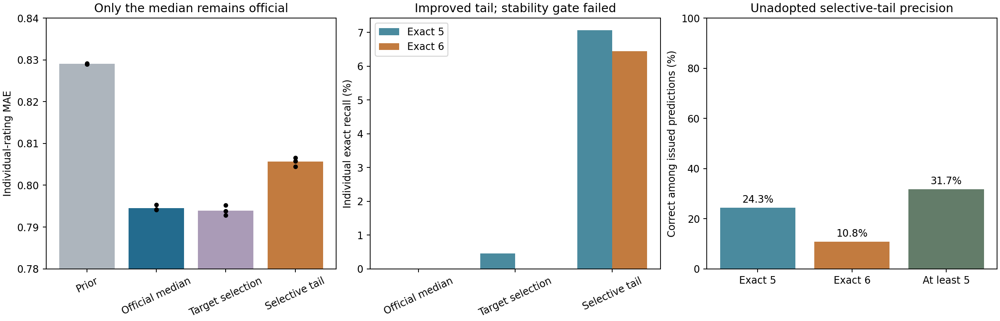

# 第一阶段：Q1实际预测能力改进

基点及开始时远端main：`d42b20a`。仅执行用户指定第一阶段；原始附件、原始逐品评记录、用户“交付”目录和历史Q2/Q3成果保留。

**当前主评分仍保留R2共享Extra Trees中位决策，个人5/6分精确召回仍为0，问题未解决。** 本轮实际训练逐目标分布森林，并实现能产生非零5/6精确命中的选择性高分决策。前者没有可靠MAE收益；后者以约0.0111 MAE增量换来尾部召回，但稳定性未达到预设替换门槛，因此只作为显式试验候选交付。本轮是已运行的部分改进及未采用决定，不能宣称正式模型预测质量或高分识别已全面改进。

正式推断入口仍为`scripts/predict_q1.py`，默认目录更新为`outputs/q1_selective_tail_20261026/`。其中正式点算法与旧R2一致、风险方法保持R2b；风险重建存在一项极小数值漂移，边界见下文。新增候选需显式`--experimental-tail`。`outputs/q1_target_20261026/`保留第一组失败实验。原任务6包没有被更新为本轮结果。

## 同口径结果与采用决定

以下均来自相同250款、相同权重、三个历史种子的重复嵌套验证，表中为三次平均；750次预测不是750款独立啤酒。

| 方法 | 个人MAE | 个人5分精确召回 | 个人6分精确召回 | 个人≥5假阳性率 | 决定 |
|---|---:|---:|---:|---:|---|
| 训练先验中位数 | 0.829054 | 0% | 0% | 0% | 简单基线 |
| 原共享ET中位数 | 0.794561 | 0% | 0% | 0% | 保留正式评分 |
| 逐目标森林leaf3 | 0.794592 | 0.391% | 0% | 0.0186% | 不采用 |
| 逐目标森林leaf1 | 0.795264 | 0.457% | 0% | 0.0238% | 不采用 |
| 训练内逐目标选择 | 0.793964 | 0.459% | 0% | 0.0191% | 不采用 |
| 训练内选择性高分决策 | 0.805629 | 7.071% | 6.444% | 1.308% | 仅试验，不替换 |

逐目标选择相对旧模型改善0.000597，95%配对区间[-0.000641, 0.001786]；第二次重复MAE还增加0.000999。未达到事先要求的0.005改善、区间和每次改善条件，因此没有依据替换。独立分裂并非当前主要瓶颈，没有继续堆叠更多森林或调树参数。

题意主要内容的45个有标签项也单列：旧模型MAE为0.775113，选择性候选为0.783212；候选个人5/6精确召回只有3.981%/6.580%，面板5/6召回8.273%/5.556%，≥5假阳性率0.791%。因此不能把含5个补充目标的50项平均7.071%召回写成Aroma/Flavour主要内容的5分召回。主内容5分表现仍弱；这项单列诊断不用于事后改变既定采用门槛。

原共享ET的逐目标宏平均高分排序AUC约为≥5的0.694、6分的0.677，说明不能由精确召回为0推断完全没有高分信息；AUC只是同批数据的描述性诊断，没有新增独立验证含义。原模型偶尔输出5分但对应实测6分，所以≥5命中与5/6各自精确命中必须分开。新森林概率的RPS/Brier未普遍改善，也未用于替换风险模型。AUC/AP计算把小于1e-12的浮点差视为并列，防止近零概率因并行累加舍入产生虚假排序；该数值处理不参与模型选择、整数决策或采用门槛。

选择性候选的逐次结果如下。面板代表值仍按原有真实加权中位数评价，没有改为自造高分标签。

| 重复 | 个人MAE | 个人5召回 | 个人6召回 | 面板5召回 | 面板6召回 | 个人≥5假阳性率 | 门槛 |
|---|---:|---:|---:|---:|---:|---:|---|
| 20261027 | 0.806617 | 7.463% | 4.582% | 15.642% | 5.263% | 1.231% | 6分召回失败 |
| 20261028 | 0.804456 | 7.612% | 6.190% | 15.642% | 10.526% | 1.387% | 通过 |
| 20261029 | 0.805812 | 6.138% | 8.561% | 12.849% | 5.263% | 1.306% | 通过 |

该流程MAE增量为0.011067，95%区间[0.008046, 0.014492]；面板中位数MAE从0.391813增至0.411200。虽然合并后的5/6召回、误报及MAE增量条件通过，第一轮个人6分召回4.582%低于冻结的5%，不能事后用合并通过替换“每次重复均通过”的要求。九个外层上下文中有三个训练内无合格候选，已明确回退中位数；没有拿外层最优政策补回。

逐目标个人MAE只有F_malt_burn改善约0.01196，23项增加、26项不变；增加最多的有A_esters_all约0.07186、co2约0.06974、aftertaste约0.05236。完整逐目标误差和逐等级混淆矩阵保留，不能用尾部平均收益掩盖这些损失。证据支持“决策抑制是零召回的重要原因”，也显示现有化学特征与当前估计器尚未提供足够稳定的尾部区分力；不证明整个化学空间永远无法预测高分。

**低总体假阳性率并不等于每次高分预测可靠。** 合并三次预测，候选5分精确率24.32%、6分精确率10.82%、≥5精确率31.71%；面板6分精确率仅1.79%。681个重复高分预测位置折算个人事件的预期误报质量为465.024，约68.29%的高分事件预测仍不正确；这些是重复预测位置及评分权重质量，不是681款或465名独立人员。候选6分对个人仍漏掉约93.56%，正式模型仍零精确召回，不能宣称高分问题解决。

额外缺失输入检验（只用外层留出输入、81个固定MCAR遮盖、原缺失保留）：5%/10%/20%遮盖时，正式模型MAE为0.796376/0.798037/0.801842，高分候选为0.806235/0.806654/0.807233。没有拿这些结果再次选择政策；它们不能代表真实信息性缺失。



## 第二组：直接优化精确高分命中

在第一组结果被查看后，另行冻结`configs/q1_selective_tail_protocol_20261026.json`，明确这是连续开发、复用同一批历史验证，未伪装为新测试。只增加一个决策家族，复用本轮已训练的共享ET，不添加新的概率估计器。

普通高分代价中位数优化加权绝对距离，并不直接奖励“预测6恰好等于真实6”。新决策只在原中位分、5、6之间选择，以真实5/6的相应训练先验频率归一化精确命中奖励，再惩罚预期MAE增量和≥5误报；lambda为0.25/0.5/1/2/4/8，mu为0/1/2/4，共24种固定政策。奖励、惩罚与候选数量均在查看本组结果前写定，没有根据外层结果加候选。

每个内层候选的5/6先验只使用其内层训练啤酒拟合，应用到对应内层验证概率。选择仍在外层训练内部完成：MAE增量≤0.02、个人及面板的5/6各自精确召回≥5%、两种≥5假阳性率≤2%，沿用R2b门槛；合格者按个人5/6平均精确召回选，再按MAE和固定顺序。无合格者回退旧中位数。正式替换还要求三次重复分别及合并结果均满足门槛、MAE增量区间上限≤0.02、全量训练内存在合格政策。未调低原有门槛；这组检验的是事先声明的尾部与总体误差权衡，不能与第一组的MAE下降门槛混同。

新评分语义明确为选择性高分决策，不是群体中位估计。默认始终保留中位数；只有显式试验命令才启用未采用政策，其输出状态和元数据均标注experimental/not_adopted，风险字段则保持原模型。

```powershell
# 先完成下文第一组训练，使用其真实分组概率；新输出目录须不存在
.venv/Scripts/python.exe scripts/q1_selective_tail_experiment.py --source '原始附件目录' --parent outputs/my_q1_target --output outputs/my_q1_tail
# 正式评分：仍为旧中位算法
.venv/Scripts/python.exe scripts/predict_q1.py --model outputs/my_q1_tail/model.joblib --input '原始附件目录/1.csv' --output outputs/my_q1_tail/prediction_smoke
# 明确请求未采用候选；不能用作正式精度或迁移通过方案
.venv/Scripts/python.exe scripts/predict_q1.py --model outputs/my_q1_tail/model.joblib --experimental-tail --input '原始附件目录/1.csv' --output outputs/my_q1_tail/experimental_smoke
.venv/Scripts/python.exe scripts/verify_q1_selective_tail.py --source '原始附件目录' --parent outputs/my_q1_target --output outputs/my_q1_tail
```

第二组目录的`experimental/`是固定repeat0的未采用候选折外评分卡，根目录评分卡为正式旧中位决策。`comparison_summary.csv`、`tail_precision.csv`、逐目标误差、两个口径混淆矩阵、24种政策和训练内选择均保留；不是只报告获选流程。`model.joblib`本机可用，不入Git。

## 题意、标签和诊断

直接读取原题PDF第2页：Q1要求由附件1给出附件3定义的Aroma/Flavour的0～6分级评分，没有指定某个品评员，也没有指定必须采用均值或中位数。因此本队继续选用群体代表整数分：预测原始个人评分分布后取条件中位数，再限制细分项不高于父项。这是团队实现选择，个人评分MAE及5/6分召回仍必须报告，不能靠改为“群体预测”抹去个人高分失败。

直接核对附件1、3、4、8：250款、226个测量属性加5个派生字段共231输入，继续排除7个未闭合汇总字段，使用224列；实际60个输入单元缺失。附件3有12张空评分卡和summary，52个命名评分项；0表示Not present，6表示Predominant/overwhelming。勾选细分项继承父项强度，未勾选为0。2197条原始记录、16位品评员覆盖50个目标，无原始标签缺失、无子项大于父项的记录。两项乙醛无标签，始终留空；空模板公式零、化学acetaldehyde和论坛描述符均未用作这两项标签。

原始单元计数：0～6分别为64425、8230、11441、11569、9054、4193、938。计数仅描述原始记录，不是独立啤酒数。啤酒等权、啤酒内品评员等权、同人重复呈样分权，沿用R1/R2口径。按此权重，5/6分质量分别为524.989837/124.847615，分母12500个“啤酒×目标”。

实测面板中位数的5分只有179个、6分19个；38个目标完全没有面板中位数6分。82.16%的个人5分质量、64.68%的个人6分质量来自面板中位数低于5的组合。即使直接使用已观察面板中位数，个人MAE仍为0.663567，个人5/6精确召回也仅17.44%/11.34%。这是描述性参照，不是可达到的预测成绩、不可突破的统计界或新群体的噪声下限。

`panel_disagreement.csv`分开给出啤酒间均值方差与啤酒内评分方差，后者占比逐目标均值69.51%；`taster_aggregate.csv`显示不同品评员相对自身面板均值的平均残差约-0.414～0.471分。后者还混有品评啤酒构成差异，不能直接解释为纯品评员效应。因此不对原始标签重新中心化，不把已知品评员ID加入新啤酒预测。

## 在查看新比较结果前固定的方法

协议：`configs/q1_target_protocol_20261026.json`，运行开始即保存内容哈希和副本。

有限候选只有：训练先验中位数、现用50目标共享Extra Trees、逐目标七级分布森林（最小叶节点3款或1款）。每个新目标森林是300树、max_features=0.7的ExtraTreesRegressor，响应为每款啤酒的七级真实加权比例，每款啤酒贡献一行。七级比例平方误差的分裂增益与分数标签Gini增益仅差比例常数；目标特异分裂不再被其余49个目标平均稀释。叶节点1或3指唯一啤酒数，没有用重复品评扩充有效样本数。

全部候选采用普通中位数和相同父项上限，没有高分加权、阈值搜索、类别重采样、化学单位转换或新概率校准。新模型的边际概率未强制父子随机序，整数输出执行父项上限；这些未校准概率只用于本轮分布预测比较，不能当成联合感官分布或迁移安全证书。

逐目标在内层两折的个人原始评分MAE上选来源；父项先选，子项候选使用已选择父项的内层整数预测计算上限及损失。平局优先现用森林，其次训练先验、leaf3、leaf1。填补只拟合当前训练的唯一啤酒；化学特征不含编号、风格、评分或论坛描述符。

外层采用既有三个种子20261027/28/29、各三折；全部同款啤酒记录跟随同一折。此方法开发使用了反复看过的同一250款、已有切分，不能称为完全未见测试或外部独立验证。三次重复产生750次啤酒预测，独立抽样单位仍只有250款。

正式点模型替换规则预先固定：平均个人MAE至少改善0.005，固定OOF损失的配对啤酒bootstrap改善95%区间下限大于0，三次重复各自均改善，且每次个人与面板高分假阳性率均不超过2%。重采样先把同款啤酒的三次损失差平均，再在风格内重采样250款；区间不覆盖重新拟合/方法选择的不确定性。

高分解决另设门槛：三次重复各自的个人和面板5/6分精确召回均至少5%，高分误报率不超过2%。MAE改善不等于此门槛通过。该门槛是团队验收选择，不是题面分数线。

## 复现和预测

Python3.12、`requirements-r3-lock.txt`；固定原始CSV由既有`scripts/fetch_raw_sensory.py`获取，已有本地副本用`--raw`传入并校验R1固定哈希。以下训练目录须不存在，预测目录也须不存在：

```powershell
.venv/Scripts/python.exe scripts/q1_target_experiment.py --source '原始附件目录' --output outputs/my_q1_target
.venv/Scripts/python.exe scripts/predict_q1.py --model outputs/my_q1_target/model.joblib --input '原始附件目录/1.csv' --output outputs/my_q1_target/prediction_smoke
.venv/Scripts/python.exe scripts/summarize_q1_target.py --source '原始附件目录' --output outputs/my_q1_target
.venv/Scripts/python.exe scripts/verify_q1_target.py --source '原始附件目录' --output outputs/my_q1_target
```

训练复用`outputs/p0_audit_20261023_final`、`outputs/raw_sensory_audit_20261025`和`outputs/task1_acceptance_20261025`的身份/字段台账，以及旧R2b的全量训练内折外概率和缺陷证据；不依赖旧模型二进制，不重跑历史21步。旧风险部分只重拟合全量ET、有序模型及校准器，并与旧全量概率逐值控制。若迁走这些历史台账或R2b证据会破坏当前入口；集中整理留到用户第三阶段。

数值重建边界：全部75000个风险值中，仅250个`coriander`的未校准6分概率与旧快照相差约1.87e-8，其他目标/事件在1e-10内，五类缺陷均在严格范围内。这一原始6分计数为0的事件，旧有序逻辑回归因累计分数的机器舍入残差拟合出约1e-7的近零概率；在原tol=1e-6下重拟合的近单类优化存在微差。核验明确要求两版该事件概率均<1e-6、漂移<1e-7，并输出逐目标逐事件差值，不把它混同为预测精度改善或全局逐位一致。没有为此修改原始标签、风险算法、五缺陷条件或整数采用门槛。

已有模型的新样本预测只需第二条命令。输入沿用附件1坐标，填补使用模型内训练统计量。模型、原始附件、下载工作簿及逐品评员原始记录均不上传GitHub。

## 输出使用

- `metrics_by_repeat.csv`、`repeat_summary.csv`、`paired_intervals.csv`：全部候选和内层选择流程的同口径比较。
- `scope_comparison.csv`：全部50项与主内容45个有标签项分别比较；不能声称52项都有实测标签。
- `metrics_by_target.csv`、`metrics_by_observed_grade.csv`、`confusion.csv`、`panel_confusion.csv`：逐目标、逐等级及两种评价口径的混淆矩阵。
- `tail_precision.csv`、`tail_by_target.csv`：5、6、≥5的召回、精确率、预期误报质量、误报率和面板计数；无预测时精确率留空，不写为0。
- `probability_metrics.csv`：个体评分概率的预期Brier、RPS、分数标签加权AUC/AP；没有个体6分的目标AUC/AP留空。
- `estimated_grades_all52.csv`、`estimated_grades_primary47.csv`、`oof_scores_all52.csv`：预先指定repeat0的折外评分卡，不逐样本挑最好的一次。两项乙醛留空。
- `full_fit_scores_all52.csv`及`prediction_smoke`：全量部署模型的训练样本推断，仅核验接口，不能报告为预测准确率。
- `missingness_summary.csv`：对外层留出输入额外随机遮盖5%/10%/20%，保持原有缺失，再用原训练模型预测。仅检验人工MCAR缺失，不涵盖信息性缺失。
- `verification.json`：分组、数值及推断检查范围；独立重拟合范围与保存模型重放明确分开。

## 与后续阶段的边界

验收证据：155项测试通过（`outputs/q1_selective_tail_20261026/unit_tests.log`）。第一组重建10个训练内选择上下文、重放全部9个保存的外层模型，另对1个外层上下文独立重拟合1个共享森林及100个逐目标森林；不是全部内层模型再次独立拟合。第二组独立重拟合全部9个共享外层森林、重建10个政策选择上下文及全部24政策，另检验81个外层MCAR输入遮盖。两组共核对39000行真实CLI输出及1500个乙醛空位；这些行数不代表独立样本数。两种实验的`verification.json`明确记录范围。

第一组训练在汇总阶段中断后修复重复指标键和beer字符串/整数合并问题，按同一协议恢复已保存的内层概率与外层模型；未因汇总故障改变方法或重新挑结果。`fit_log.csv`将恢复操作与新拟合分开，恢复项耗时留空，没有补造运行时间。AUC并列精度和风险数值差异另按上述边界核验，均未用于调低模型质量门槛。

新点预测分布与旧风险模型分开。上线风险字段保留R2b方法、状态及Stale证据不足结论；预测元数据显式标注来源，重建数值漂移如上。没有新增迁移后的酿造/品评实测。本轮正式点模型和五缺陷风险未被新候选替换，阶段二仍可在原证据范围内复用旧模型对照；若将来采用新点/风险模型，必须重算必要Q3守卫与基准。旧113520点、8293点阻断集合及零通过结论仍仅属于旧模型/旧约束情景，不能移作试验高分候选的结论。

本轮由OpenAI Codex辅助设计、编码、运行、核验和记录，未使用子代理。主模型高分识别、两项缺标签、Stale弱证据和迁移后实测效果仍未解决。第一阶段的代码和实验交付不等于这些科学问题已经解决。

旧任务6论文取数包保留为此前正式结果快照，未自动纳入本轮新结果。阶段三再统一最终交付；本轮不执行Q3搜索、不改Q2、不重跑历史全链。
