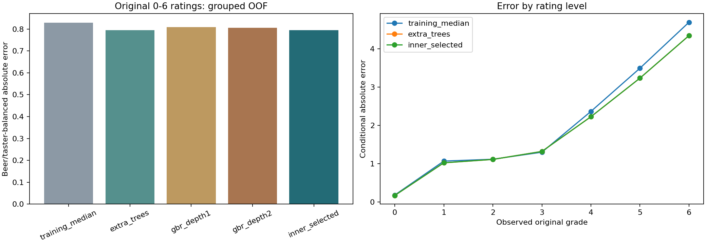

# R2：原始量尺Q1目标定义与有限对照

后续状态：2026-10-26已完成[R2补充高分与缺陷风险](R2补充_高分与缺陷风险_20261026.md)。默认模型目录改为`outputs/r2b_tail_risk_20261026`并新增概率；高分候选未达标，整数评分仍保持本页R2结果一致。本页保存原阶段实验及其独立复现命令。

R2已完成。**Q1默认预测入口采用原始0～6分上的群体中位评分模型**，所选方法为Extra Trees；新的主要结果位于`outputs/r2_raw_q1_20261026/`。该模型在固定三折上的加权真实品评分数绝对误差为0.795214，优于训练中位数基线的0.829079。两项乙醛仍无原始专家标签，在完整52项视图中留空。

这不是把旧相对等级的MAE从1.47降到0.80：标签、加权和评价对象均已改变，旧数字不能直接比较。旧相对等级模型可显式加载，原结果作为历史保留。Q2、Q3仍是R2前的目标/画像口径，等待R3及任务4逐项衔接；本阶段未重建其结果。

## 目标、权重与整数决策

输入仍来自250款啤酒：226项直接测量的化学/理化属性，加5项派生量，共231个原始输入字段。本阶段沿用当前主协议，排除7个定义未闭合的汇总字段后使用224项；ID、风格标签和附件相关矩阵不进入预测特征。

标签使用[R1已验证身份的原始品评记录](R1_原始感官评分审计_20261025.md)：2197条记录、50项0～6整数评分。每款啤酒权重相同；在一款啤酒内每名品评员等权，同一人的多次呈样平分其权重。若品评员t对啤酒b有r次记录、该啤酒有T名品评员，每次记录的权重为`1/(T*r)`，每款总权重为1。不做品评员z标准化，不做相对ECDF。

模型输出对象是上述人群权重下的条件中位评分。整数取0～6中使期望绝对误差最小的动作，平局取较低等级；GBR的连续0.5分位预测先取最近整数，半整数向下取。所有方法统一施加24个“子项不高于父项”的整数约束。此规则适用于群体摘要，不强迫它等同某一人的完整评分卡。

例如一半权重为0、一半为6，任何0～6整数的绝对误差相同，本阶段按固定平局规则输出0。因此**预测0表示群体中位评分为0，不表示无人感知或化合物不存在**。它也不是精确预测某个人一定给出的分数。

主指标为对个人原始评分的加权绝对误差，再按250款和50目标等权平均。辅助指标包括对实测加权面板中位数的MAE/命中率、按原始等级分层的误差、逐目标表现和品评差异。观察到的每款实测面板中位动作自身平均绝对偏差为0.663567分；这是样本内分歧摘要，不是可保证达到的泛化性能或不可约噪声下界。

## 冻结的有限实验

训练前写定[协议](../configs/r2_raw_panel_protocol_20261026.json)，没有根据外层结果追加候选或修改标准。

| 方法 | 实现与用途 |
|---|---|
| training_median | 只用训练啤酒的均衡评分分布，取逐目标中位数，作为无化学特征基线 |
| extra_trees | 300棵共享多输出分类树、max_features=0.7；按上述原始记录权重拟合，预测概率的整数中位数 |
| gbr_depth1 | 每目标100棵深度1树，learning_rate=0.05，0.5分位损失，max_features=0.7 |
| gbr_depth2 | 同上，树深度为2 |

GBR采用分位损失是为了与本阶段绝对误差/中位评分目标一致，不是逐字复制原论文的均值回归。`loss='quantile', alpha=0.5`及样本权重依据[scikit-learn 1.7文档](https://scikit-learn.org/1.7/modules/generated/sklearn.ensemble.GradientBoostingRegressor.html)；Extra Trees的类别概率与加权叶限制依据[对应文档](https://scikit-learn.org/1.7/modules/generated/sklearn.ensemble.ExtraTreesClassifier.html)。

中位数填补只在唯一训练啤酒的224维特征矩阵上拟合，然后展开为品评记录，防止重复品评次数改变填补统计。各叶最小训练权重为3款啤酒，使用`min_weight_fraction_leaf=3/n_train_beers`实现；同一啤酒总权重为1，重复记录不能绕过此限制。

外层沿用R1登记的按细风格分层三折，种子20261024；内层两折，在全部50目标的主指标上选择一个全局方法。平局按协议候选顺序处理，不按外层结果逐目标拼接。每款啤酒全部品评记录均在同一折。全数据部署也重新做两折训练内选择。共45次候选拟合，其中GBR的每次多输出拟合内部含50个单目标模型。

## 结果与采用决定

| 方法 | 全50维真实评分加权MAE | 对观察面板中位数的MAE | 面板中位数完全命中率 |
|---|---:|---:|---:|
| 训练中位数基线 | 0.829079 | 0.447920 | 71.432% |
| Extra Trees | **0.795214** | **0.392800** | **74.128%** |
| GBR深度1 | 0.808638 | 0.409680 | 73.480% |
| GBR深度2 | 0.805131 | 0.408320 | 73.408% |
| 内层所选流程 | **0.795214** | **0.392800** | **74.128%** |

三个外层训练过程和全数据训练内选择均选中Extra Trees。所选流程对个人原始评分的加权完全命中率为60.492%、误差不超过1级为78.303%；这些数值与“面板中位数命中率”是不同的评价对象。

按风格分层、以啤酒为抽样单位，对固定折外损失做2000次配对bootstrap，基线减所选流程的MAE改善为0.033865分，95%区间[0.029624，0.038060]。满足训练前的采用条件：平均改善为正且改善区间下端为正。据此将原始量尺模型用于Q1默认入口。区间只条件于已拟合模型和历史划分，不涵盖全部重拟合/方法选择不确定性，也不是外部独立验证。



## 仍须保留的限制

50个目标中24个优于基线、21个相同、5个略差。不能把总体改善说成每个维度都可靠。

| 缺陷目标 | 基线真实评分MAE | 所选流程MAE |
|---|---:|---:|
| Diacetyl | 0.561962 | 0.561962 |
| DMS | 0.676611 | 0.677468 |
| 4VG | 0.547649 | 0.547649 |
| trans-2-nonenal | 0.350827 | 0.350827 |
| Stale hops | 0.238056 | 0.238056 |

对个人给出的5分和6分，所选整数动作的精确命中率均为0；6分条件下平均误差为4.346分。原始加权面板中位数本身也有179个5分、19个6分位置，不能因为罕见便忽略。当前中位决策偏向中低等级，需要在论文中保留这一弱点，不把低总体误差解释为尾部识别充分。

Extra Trees所选流程的6000个子项/父项检查均通过，约束前也没有违反；GBR深度2原有3处违反，经统一封顶后为0。通过整数层级检查不代表真实缺陷干预效果已验证，尤其不能用近似常数的Stale预测自动证明迁移不恶化。

在已有真实缺失外，再增加5%/10%/20%的随机缺失各3次，所选流程平均MAE分别为0.796401、0.797825、0.802730。全部逐折/重复结果保存，不将随机缺失压力测试当成对任意非随机缺失机制的保证。

## 交付、重建与调用

| 文件 | 内容 |
|---|---|
| estimated_grades_primary47.csv、estimated_grades_all52.csv | 当前250款的折外整数评分宽表；两项乙醛留空 |
| oof_scores_all52.csv | 13000个评分卡位置，含预测角色及两个缺口 |
| oof_predictions.csv.gz | 五种方法/流程共62500条折外预测及原始评分加权损失 |
| observed_panel_distribution.csv | 12500个啤酒×目标的均衡实测分布、中位数与均值 |
| model_comparison.csv、fold_metrics.csv、metrics_by_target.csv | 总体、三折及逐目标结果 |
| metrics_by_observed_grade.csv、confusion.csv | 按真实原始等级加权的误差和混淆矩阵 |
| inner_predictions.csv.gz、inner_splits.csv、inner_selection.csv | 150000条内层预测、分组划分及四个选择上下文 |
| rating_weights_and_folds.csv | 全部2197条记录的权重与啤酒分组 |
| missingness_by_fold.csv、missingness_summary.csv | 27组逐折压力测试及9组完整样本汇总 |
| paired_uncertainty.csv、panel_disagreement.csv、hierarchy.csv | 固定损失区间、观察分歧及层级检查 |
| full_fit_*.csv、model.joblib | 全数据拟合部署结果；不是折外性能证据，模型二进制不随Git上传 |
| verification.json | 实际核验范围 |

新克隆安装requirements-lock.txt后，从根目录重建到一个不存在的目录：

```powershell
.venv/Scripts/python.exe scripts/fetch_raw_sensory.py
.venv/Scripts/python.exe scripts/r2_raw_q1.py --source '原始附件目录' --output outputs/my_r2
.venv/Scripts/python.exe scripts/predict_q1.py --model outputs/my_r2/model.joblib --input '原始附件目录/1.csv' --output outputs/my_r2/prediction_smoke
.venv/Scripts/python.exe scripts/verify_r2_raw_q1.py --source '原始附件目录' --output outputs/my_r2 --smoke outputs/my_r2/prediction_smoke
```

离线数据可通过`--raw`传给训练与核验命令；下载若遇本机失效代理可加`--no-proxy`。当前本机`predict_q1.py`默认模型路径是`outputs/r2_raw_q1_20261026/model.joblib`；新机器按上述命令重建后显式传入新模型路径即可。CLI输出同样保留52项视图，50项为原始量尺群体中位预测，2项无标签留空，信息文件明确标示训练内推断而非OOF。

显式传入旧`outputs/q1_task2_20261025/model.joblib`仍走原有相对等级/阈值情景代理分支。本阶段已实际运行两种CLI。原19步统一复现入口仍覆盖R2之前的Q1及现有Q2/Q3；R2通过上述独立入口重建，最终统一属于任务6。

## 验证与停止点

115项测试通过，其中新增7项验证品评员均衡权重、中位数损失、无效标签拒绝、唯一啤酒填补、重复记录下的叶权重、父子约束与无标签项。核验独立从原始记录重数评分分布和风险、复算指标/选择/区间，重拟合12个外层候选，验证真实CLI和500个无标签空位置；详情以`verification.json`实际通过记录为准。内层及全数据拟合模型未全部重复训练，未运行任务5的重复外层划分。

R2完成后停止，下一项R3为按该新目标定义增补Q2非线性解释，等待用户指令。
