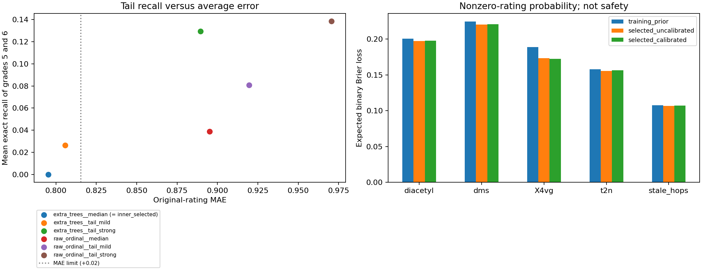

# R2补充：高分识别与缺陷概率诊断

本项完成了约定的有限实验，**高分评分方案未达标，保留R2中位评分作为暂用点预测**。新增非零评分、高分及6分概率，并同时输出校准前后结果。五类缺陷中四类的非零评分概率在既有留出划分上优于训练常数基线，Stale证据不足；这些结果不能证明真实迁移后缺陷不恶化。两项乙醛继续留空。

当前默认`predict_q1.py`使用本目录可重建的模型。默认整数评分与R2一致，MAE仍为0.795214，个人5/6分精确召回仍为0。改动在于把“中位评分为0”和“所有品评员都感知不到”区分开，并给出概率与证据状态。本项没有启动R3、修改Q2/Q3或代写论文。

## 数据、方法与冻结条件

基点`3e4dcb8`，沿用R1身份与R2权重：250款啤酒、2197条原始记录、50项0～6分，啤酒等权、啤酒内品评员等权、同一人的重复呈样分权。226项测量属性加5项派生量共231输入，沿用排除7个定义未闭合汇总字段后的224特征；编号和风格不作预测输入。

[训练前协议](../configs/r2b_tail_risk_protocol_20261026.json)固定两个概率模型：R2 Extra Trees及原始量尺累计阈值逻辑回归。后者对六个累计事件分别拟合，缺失填补、asinh变换及标准化均只在当前训练啤酒拟合，再通过保序投影还原七级分布。分数比例以二元样本分权展开，等价于对分数标签的交叉熵；不是先把每个人的评分当作独立啤酒随机划分。

每个模型固定三种整数决策，共六个候选：普通中位数、5/6分代价为2/4倍、5/6分代价为4/8倍。代价作用于观察真值等级，选择加权绝对损失最小的整数，最后施加子项不高于父项的规则。后两种决策不再叫群体中位数。

仍为外三折、内两折，同一啤酒全部记录在同一折。内层候选必须同时满足：相对R2的MAE增加不超过0.02；个人评分及实测面板中位数的5/6分精确召回各至少5%；两个口径的高分假阳性率均不超过2%。符合者按个人5/6分平均召回选择，平局按MAE及固定候选顺序；无符合者明确回退。外层所选流程还须满足同样限制，且配对啤酒bootstrap的MAE增量95%区间上限不超过0.02，才可替换点预测。

这是在看过R2结果后进行的方法开发，仍用同一250款及划分；训练内选择避免本轮外层调参泄漏，但不能把它称作新外部独立测试。后续冻结方法后的重复验证仍按原计划待做。

## 高分实验结果

以下均为折外预测；召回以真实个人评分权重计算，高分假阳性指真实分数低于5却预测至少5。

| 候选 | 原始评分MAE | 5分精确召回 | 6分精确召回 | 高分假阳性率 |
|---|---:|---:|---:|---:|
| ET普通中位数（现用） | 0.795214 | 0% | 0% | 0% |
| ET温和高分代价 | 0.805749 | 5.27% | 0% | 0.58% |
| ET强高分代价 | 0.889465 | 24.86% | 1.00% | 4.15% |
| 有序模型普通中位数 | 0.895145 | 7.47% | 0.33% | 0.93% |
| 有序模型温和高分代价 | 0.919481 | 13.37% | 2.79% | 2.27% |
| 有序模型强高分代价 | 0.970562 | 24.08% | 3.62% | 5.36% |

四个内层上下文（3个外层训练集和全量训练集）均无符合全部条件的候选，最终都回退ET普通中位数。温和代价确实让一部分5分得到命中，但没有改善6分；更强代价牺牲总体误差并增加误报。实测面板中位数口径也未同时达到5/6分要求，全部指标保留在[对照表](../outputs/r2b_tail_risk_20261026/point_comparison.csv)。没有在看到结果后放宽标准，也没有强行输出5/6分宣称修复。

因此当前评分状态为`provisional_baseline_tail_not_qualified`。高分预测仍是未完成的科学问题，本项完成的是这一轮预先限定的优化和失败原因诊断。

## 缺陷概率及校准

新增概率定义是：按既定品评员权重抽取一次评分，其分数至少1、至少5、恰为6的概率。它不是化合物超过浓度阈值的概率，也不是某款啤酒缺陷安全的概率。

逐目标在内层折外预测上，以**未校准的非零评分Brier损失**从训练先验、ET和有序模型中选择来源，先验在平局时优先。选好后仅用外层训练集的内层折外概率及标签，拟合六个单调sigmoid再校准器并进行保序投影；选择先验的目标直接保留训练先验。外层测试标签不参与来源选择或拟合校准。所有目标包括高分事件都输出诊断；下面的证据状态只针对五类缺陷的“评分非零”事件。

| 缺陷 | 训练先验Brier | 未校准ET | 校准后所选流程 | 相对先验改善的99%区间 |
|---|---:|---:|---:|---|
| Diacetyl | 0.200509 | 0.197522 | 0.197871 | [0.000323, 0.004843] |
| DMS | 0.224613 | 0.220110 | 0.220781 | [0.001188, 0.006462] |
| 4VG | 0.188872 | 0.173479 | 0.172532 | [0.009724, 0.024211] |
| t2n | 0.157957 | 0.155546 | 0.156605 | [0.000028, 0.002752] |
| Stale hops | 0.107343 | 0.106599 | 0.107018 | [-0.000183, 0.000886] |

Brier越低越好，按真实个人评分计算期望二元损失，保留同一啤酒内部的评分差异。区间是固定OOF损失、按啤酒配对并保持风格构成的2000次重采样；不包括重新训练和方法选择的不确定性。四类的区间下限为正，标注`historical_nonzero_probability_support_not_safety`；Stale为`insufficient_heldout_probability_support`。四项仅代表相对常数基线的历史描述性支持，不能扩展为高分概率也已通过检验。

**校准没有普遍改善预测。** 五类中四类校准后Brier略高于未校准ET，只有4VG改善；非零事件的分箱ECE在四类下降、t2n上升。保留`selected_uncalibrated`与`selected_calibrated`完整对照，未根据外层结果事后挑选哪个版本报成绩。校准是拟合方法的名称，不是可靠性保证。[scikit-learn校准文档](https://scikit-learn.org/1.7/modules/calibration.html)也说明Brier同时反映可靠性与分辨能力，不能仅由一个损失认定校准充分。逻辑回归实现依据[官方接口](https://scikit-learn.org/1.7/modules/generated/sklearn.linear_model.LogisticRegression.html)。

所有行的`safety_certified=False`。后续Q3不能因整数评分为0，或采用校准概率，就自动认定缺陷不恶化；仍需任务4的完整约束与任务5的验证，并明确迁移后实测证据缺失。两项乙醛没有原始专家标签，分数和概率均留空；旧阈值情景只可在声明单位和阈值假设后单列，不补造标签。

## 文件与调用

结果目录：[outputs/r2b_tail_risk_20261026](../outputs/r2b_tail_risk_20261026/)。

- `estimated_grades_primary47.csv`、`estimated_grades_all52.csv`：250款折外整数评分，准确率分析用这一组；后者含两项空乙醛列。
- `oof_scores_all52.csv`：13000条逐项折外评分、概率和证据状态，其中500条乙醛空位。`oof_rating_risks.csv`另列12500条有标签目标的风险。
- `full_fit_scores_all52.csv`、`full_fit_grades_all52.csv`：全量拟合后的训练样本输出，用于核验调用，不能拿来报折外成绩。
- `probability_rating_ge1/ge5/6`为校准流程输出；`uncalibrated_probability_rating_ge1/ge5/6`保留校准前结果，三者分别代表至少1、至少5和恰为6。`risk_source`、`risk_validation_status`和`calibration_quality_status`须一同使用。
- `point_comparison.csv`、`point_inner_selection.csv`、`point_uncertainty.csv`：全部高分候选、训练内选择与门槛判断。
- `risk_metrics.csv`、`risk_reliability.csv`、`defect_risk_validation.csv`：五种概率流程的损失/ECE、固定分箱可靠性及五缺陷区间。
- `inner_probabilities.csv.gz`、`oof_base_probabilities.csv.gz`、`oof_risk_probabilities.csv.gz`、`oof_point_predictions.csv.gz`：复核的概率和整数预测，另存折号、来源选择、校准参数及拟合记录。
- `summary.json`、`verification.json`、`cli_verification_info.json`：结论、核验范围及实际CLI来源哈希。模型二进制和原始下载数据不入Git。



新克隆安装锁定依赖后，在仓库根目录执行（输出目录须不存在）：

```powershell
.venv/Scripts/python.exe scripts/fetch_raw_sensory.py
.venv/Scripts/python.exe scripts/r2b_tail_risk.py --source '原始附件目录' --output outputs/my_r2b
.venv/Scripts/python.exe scripts/predict_q1.py --model outputs/my_r2b/model.joblib --input '原始附件目录/1.csv' --output outputs/my_r2b/prediction_smoke
.venv/Scripts/python.exe scripts/verify_r2b_tail_risk.py --source '原始附件目录' --output outputs/my_r2b --smoke outputs/my_r2b/prediction_smoke
```

离线已有原始评分可对训练及核验传`--raw '文件路径'`，仍核验R1固定哈希。新样本须与附件1输入坐标一致；仅评分用`predict_q1.py`并显式指定模型和输入，不自动转化学单位。默认模型路径为本次已提交结果目录中的`model.joblib`，需先按该目录运行训练重建，或像上例显式指定自己的输出。

原19步`reproduce_current.py`仍是旧Q1/Q2/Q3整合链，本项使用独立入口；任务6再统一正式复现流程。

## 已做验证及下一步

121项测试通过。独立重拟合6个外层基础模型，重建4个训练内来源选择/校准上下文，重算112500条内层概率、25000条基础OOF概率、37500条风险概率和87500条候选整数预测的相关选择及指标；内层基础模型及全量有序模型未全部独立重拟合。另按R2冻结参数重新拟合全量ET，确认暂用评分逐项一致，不依赖旧二进制。实际CLI的13000条输出、500个乙醛空位、源文件与模型哈希核验通过。

本次交付拟合日志保留25条基础拟合，含一条已明确标为`superseded_full_forest_seed`的全量森林（对齐R2全量随机种子时被替换）；交付模型采用R2的`model_seed+999`，OOF实验不受影响。按最终脚本全新重建为24次基础拟合，不需要重现被替换的拟合。

本项完成并推送main后停止。R3及任务4～6仍未启动，须用户下一步指令。R3应按原始评分口径解释，并保留本项的弱预测目标状态；本项没有把四个概率支持状态升级为迁移控制保证。
