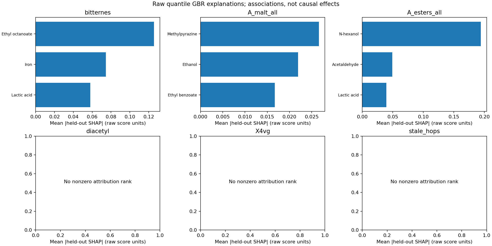

# R3：原始量尺Q2非线性解释增补

后续评估：2026-10-26[优化任务5](任务5_冻结方法重复嵌套验证_20261026.md)补充三个随机划分的训练内选择及折外SHAP稳定性。每个重复仍只有17目标非零GBR排名，精确Top-3会变；本页原阶段排名/注释保留，重复结果不自动替换化学证据。

R3完成了约定的有限GBR、折外SHAP、原始量尺Ridge对照及相关模块/稳定性检查。**保留旧Q2主表，新原始量尺结果单独交付；Q1仍使用R2补充的Extra Trees，Q3尚未改动。**

新结果在`outputs/r3_raw_explanation_20261026/`。GBR折外原始评分MAE为0.807566，优于训练中位数基线0.829079，但弱于现用Q1的0.795214。50目标中，17个产生非零GBR归因，共51条Top-3；其中10个目标通过预设的历史预测支持描述条件。另33个目标当前中位数模型的归因为0，不凑出99条任意排名。两项乙醛仍缺原始专家标签。

## 借鉴原论文的部分与本轮区别

[原研究](https://www.nature.com/articles/s41467-024-46346-0)的方法部分使用品评员标准化后的z分数；文中Fig.4展示的GBR/SHAP重点是消费者喜好预测。它提供“非线性预测与逐样本贡献并用”的方法参考，不意味着本题每一项原始强度都有已验证的化合物排名，也不构成同源250款数据的独立验证。

本轮沿用R2的原始0～6分布：每款啤酒等权、啤酒内品评员等权、重复呈样分权。GBR直接拟合这些原始记录的0.5分位数，得到群体中位决策；它与原研究的标准化响应并非同一模型。Ridge保留既有asinh、标准化X、alpha=1000的方法，改以均衡原始评分均值为响应。该做法等价于对分权原始记录做平方损失拟合；**均值和中位数是不同的响应概括，不能把二者解释或成绩混称同一对象。**

所有模型仍采用R2的224个预测输入：250款、226项测量属性加5项派生量共231字段，排除7个定义未闭合的汇总量后建模。严格单体排名池仍为219项；允许IBU化学家族指标的220项口径只作补充。编号、风格标签不进入模型。

## 冻结实验及解释对象

[协议](../configs/r3_raw_explanation_protocol_20261026.json)在训练前固定。沿用三折外层、两折内层，啤酒为分组单位且保持风格比例；所有品评记录跟随所属啤酒。GBR仅比较R2固定参数的深度1/2两档，按内层原始个人评分MAE全50目标共同选择，平局按固定顺序。三个外层依次选深度2、2、1。Ridge固定alpha，不做事后目标挑选。

每折仅从外层训练啤酒随机抽100款作为解释背景。GBR采用精确interventional Tree SHAP（SHAP 0.49.1，非近似模式），只解释该折未参与拟合的啤酒。Ridge以同一组背景，在变换后的X坐标计算`系数×(输入−背景均值)`，得到独立背景假设下的线性贡献。

GBR贡献之和加基值，还原的是**取整、截断及父子封顶之前的GBR连续分位输出**。Ridge贡献还原的是连续均值预测。二者都不是当前Q1 Extra Trees的解释，也不声称逐项还原最终整数评分。`additivity_and_postprocessing.csv.gz`另存这些后处理变化，防止把它们归给某个化合物。

GBR按全250款折外`平均绝对SHAP`选Top-3；原始Ridge按三折训练模型的`平均绝对标准化系数`选Top-3。两种分数的数值不直接混比。方向字段是原始输入坐标与折外贡献的边际Spearman关联，不是单调浓度效应或调配导数。[TreeExplainer文档](https://shap.readthedocs.io/en/latest/generated/shap.TreeExplainer.html)说明背景依赖假设与加和含义；[GBR接口](https://scikit-learn.org/1.7/modules/generated/sklearn.ensemble.GradientBoostingRegressor.html)说明quantile损失及alpha的响应定义。interventional是归因计算假设，不自动赋予观察数据因果识别能力；高度相关输入在背景替换后也可能形成实际少见组合。

## 预测表现及哪些目标可解释

| 方法 | 原始个人评分MAE | 本轮历史支持目标数 | 用途 |
|---|---:|---:|---|
| 外层训练中位数 | 0.829079 | — | 无化学特征基线 |
| 内层选择的GBR | 0.807566 | 10/50 | 本轮非线性解释对象 |
| 原始均值Ridge | 0.948413 | 11/50 | 均值响应的线性对照 |
| 现用Q1 Extra Trees（R2既有结果） | 0.795214 | 本轮未重判 | Q1评分保留原模型 |

“历史支持”仅指逐目标MAE相对训练中位数改善至少0.01，且固定OOF损失、按啤酒配对并保持风格构成的2000次bootstrap之95%区间下限为正。50目标区间没有多重比较调整，也没有包含重拟合/选择不确定性；这是开发数据上的描述性状态，不是50项同时有效的显著性结论。其余目标标为`weak_predictor_exploratory_only`，全部`migration_control_validated=False`。

GBR通过该描述条件的10项为：A_malt_all、A_esters_all、F_malt_all、F_hops_all、F_hops_noble、F_esters_all、bitternes、sweetness、alcohol、aftertaste。另7个有非零归因的目标仍属弱预测，只能作探索。

五类缺陷X4vg、diacetyl、dms、t2n、stale_hops的GBR中位数预测均未改善常数基线，且没有非零归因排名。这不证明缺陷不存在或没有化学机制，而是当前中位响应没有提供可用的因素区分。R2补充解释的是ET对“随机一次评分非零”的概率，四项有相对先验的历史支持；它与这里的中位数失败可同时成立。**不能用本轮零归因或零整数预测，为Q3缺陷不恶化背书。**

## 相关替代、稳定性与化学解释

每个外层训练集单独计算填补后的输入Spearman图，阈值`|rho|≥0.7`，连通分量作为相关组；模块成员及带符号边均保存。连通分量具有传递性，不意味着同组任意两字段都达到阈值，也不自动代表同一生化途径。模块归因先对有符号贡献求和，再求绝对均值，避免把正负抵消重复计入。

例如严格单体口径的苦味前三项为ethyl_octanoate、iron、lactic_acid.mg.L.。这不是“辛酸乙酯是苦味的首要直接呈味物”。辛酸乙酯在三个训练折中均与若干乙酯、甘油和乙醇进入同一相关组，说明模型依赖了共变信息，不能据此锁定单体干预。允许IBU家族指标的补充口径将`bitterness`排在第一，后两项为ethyl_octanoate、iron；该指标依旧不能当作一个独立分子，也没有为了符合常识而改严格单体榜单。

稳定性只来自三个外层重拟合：逐折Top-3、入选频率、折对Jaccard和全候选重要性秩相关。GBR的17个非零目标、51个折对的平均Top-3 Jaccard为0.154902；原始Ridge的50目标、150折对为0.286667。两个平均数覆盖的目标集合不同，不能当作公平的模型稳定性优劣检验；它们均说明精确锁定单个前三项仍不稳。33个GBR全零目标的折对Jaccard留空，避免把“都没识别”算成完美一致。全局前三项也可能在任何单折中都未进前三，表内如实保留0入选率。

在17个非零GBR目标内，新GBR与原始Ridge的平均Top-3 Jaccard为0.276471，与旧标准化Ridge为0.305882；原始Ridge与旧Ridge在全50目标平均为0.604000。响应、估计对象和排名方法均改变，这些是差异摘要，不是新榜单更正确的证据。

文献只迁移既有任务3的**相同target+field配对注释**。GBR的51条中21条匹配、30条新配对明确未审查；Ridge的150条中108条匹配、42条未审查。匹配也只表示沿用原注释，不能当成原始量尺下的因果验证。没有把旧z标签下的bootstrap频率、置换P或BY q搬到本轮排名，原表完整保留。



## 使用文件与复现

- `top3_raw_all50.csv`：两种方法共201条可识别排名（GBR 51、Ridge 150），含预测支持、三折频率、相关邻居及文献匹配状态。
- `top3_raw_all52_slots.csv`：每种方法52×3，共312个位置；GBR有99个零模型归因空位，另有6个乙醛缺标签空位；Ridge有6个乙醛空位。两种缺口原因分开记录。
- `family_top3_supplement.csv`：220候选家族口径。`historical_rank_comparison.csv`比较新旧排名，不覆盖旧150条主结果。
- `predictive_metrics.csv`、`oof_predictions.csv.gz`：全部50目标的表现、支持状态及折外整数预测。
- `*_OOF_attributions.npz`：250×50×224贡献、基值、连续输出及ID/字段顺序；不能用图里的少数案例替代完整结果。
- `fold_factor_scores.csv.gz`、`all_factor_scores.csv.gz`、`fold_top3.csv`、`rank_stability.csv`：全候选重要性及三折重拟合稳定性。
- `training_correlation_edges.csv`、`training_module_members.csv`、`fold_module_scores.csv.gz`、`fold_module_top3.csv`：训练内相关组与逐折组贡献，组ID不能跨折直接对齐。
- `inner_predictions.csv.gz`、`inner_selection.csv`、`inner_splits.csv`、`background_beers.csv`、`fit_log.csv`：训练内选择、背景与分组追溯。
- `additivity_checks.csv`、`additivity_and_postprocessing.csv.gz`、`summary.json`、`verification.json`：数值及来源核验。配置/旧输入文件哈希统一CRLF→LF后计算，原始附件与原始评分仍按字节哈希校验。

PowerShell，输出目录须不存在：

```powershell
.venv/Scripts/python.exe -m pip install -r requirements-r3-lock.txt
.venv/Scripts/python.exe scripts/fetch_raw_sensory.py
.venv/Scripts/python.exe scripts/r3_raw_explanation.py --source '原始附件目录' --output outputs/my_r3
.venv/Scripts/python.exe scripts/verify_r3_raw_explanation.py --source '原始附件目录' --output outputs/my_r3
$env:PYTHONPATH='src'
.venv/Scripts/python.exe -m unittest discover -s tests
```

已有原始评分可对训练及核验传`--raw '文件路径'`。SHAP依赖单独锁定，沿用现有核心建模版本；无SHAP的旧环境仅跳过本次Tree SHAP单元测试，R3交付环境已实际运行。源数据和折模型二进制不入Git，按命令重建即可；本轮不产生或切换Q1部署模型。旧19步统一入口仍不包含R1后新链，待任务6统一。

## 验证及后续接口

127项测试通过，含原始均值/分权平方损失等价性、线性归因重构、零效果留空、正负相关组、模块贡献抵消及精确分位Tree SHAP测试。独立重拟合全部18个本轮模型（12个内层GBR、3个外层GBR及3个外层Ridge），重算6组折外解释、每种方法280万归因单元、50000条内层预测与13组派生表；最大加和误差`2.52e-8`。训练内背景、填补、相关图和缺标签空位均已复核。复核使用相同数据与划分，是数值重放，不是新增外部验证。

Q2交付现在由“旧标准化响应完整关联主表＋本轮原始量尺非线性增补”共同组成，不能只用新51条声称解释了全部52项。后续任务4必须读取预测支持与空位原因，保留五缺陷中位预测无有效因素的限制；本轮的任何SHAP项都没有自动成为可干预控制变量。任务4仍须用户下一步指令才开始。
