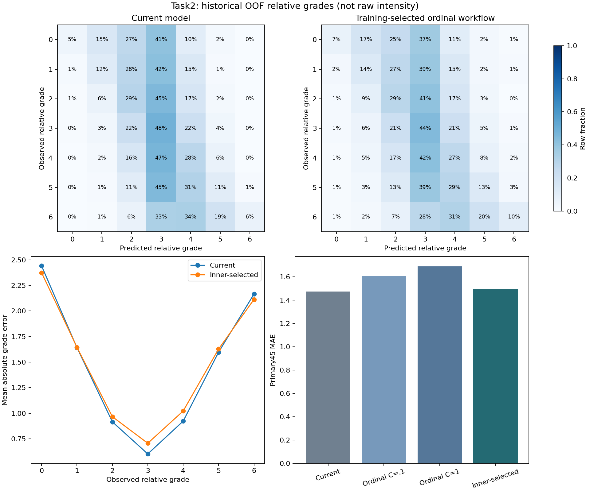

# 优化任务2：Q1有序预测有限对照

2026-10-25；接手`b207b46`。本阶段仅执行分任务清单中的优化任务2。结论：**两档有序模型及训练内逐目标选择均未改善主要目标的总体MAE，保留当前官方主模型和主结果。**任务3及后续任务须等用户下一步指令。

## 冻结的比较方法

执行前固定`configs/task2_ordinal_protocol_20261025.json`，结果目录保存同内容`protocol.json`及其规范化JSON内容哈希。只比较三个候选，不根据外层结果继续扩大网格：

1. 当前300树多输出ExtraTrees分类器及条件中位数决策。
2. 逐目标累计阈值逻辑回归，C=0.1。
3. 相同累计阈值方法，C=1。

累计模型对每个目标分别拟合六个事件`grade > k`（k=0～5）；每个模型使用训练中位数填补、训练asinh压缩及标准化。六个概率如违反次序，用最小二乘保序投影修正为非递增，再由相邻差分恢复七级概率，采用条件中位数最小化其期望绝对等级误差。保序投影只保证概率次序，不意味着概率已经校准。

方法依据为Frank与Hall的累计二分类有序分类思路；本任务具体采用逻辑回归与概率保序投影，没有照搬原研究中的分类器或声称同样效果：[原始论文](https://researchcommons.waikato.ac.nz/entities/publication/ce0009f5-92fa-4113-b8b2-7ac929cfd32c)、[scikit-learn保序投影文档](https://scikit-learn.org/stable/modules/generated/sklearn.isotonic.isotonic_regression.html)。实际依赖仍为仓库锁定版本，无新增安装包。

保留原历史三折；每个外层训练集内部做两折。每次内层训练只用自身训练行拟合缺失处理、变换和等级参考分布，内层验证行仅用于计算误差。每个感官目标选择内层汇总MAE最小的方法，平局优先保留候选列表较早的方法，再在整个外层训练集重拟合。没有用外层标签决定逐目标方法，也不从外层结果挑一个表现最好的固定C。

50项有面板标签的目标均报告，主要比较分母为45项Aroma/Flavour目标、250款共11,250条。两个Acetaldehyde阈值代理不进入准确率分母。标签仍是训练参考下的相对等级，不是原始评分卡强度。

## 结果与保留决定

| 方法 | 45项目标MAE | 完全命中 | 误差≤1级 |
|---|---:|---:|---:|
| 当前主模型 | **1.471556** | 20.0089% | 54.8711% |
| 固定累计模型C=0.1 | 1.604444 | 21.5556% | 54.8178% |
| 固定累计模型C=1 | 1.688622 | 21.3956% | 52.9867% |
| 训练内逐目标选择 | 1.495467 | 20.5867% | 54.9778% |

训练内选择在三折中的MAE分别为1.494974、1.465328、1.526104，三折均差于相应当前基线；不能因完全命中率略高就宣称总体预测改善。

| 观测相对等级 | 当前MAE | 训练内选择MAE | 当前完全命中 | 训练内选择完全命中 |
|---|---:|---:|---:|---:|
| 0（1612条） | 2.441067 | 2.374690 | 4.5285% | 6.8238% |
| 6（1617条） | 2.165739 | 2.113173 | 6.4935% | 10.2041% |

两端有所改善，中央等级误差增加。主指标MAE净增加0.023911级。2000次按风格分层、以啤酒为单位的固定折外损失配对bootstrap中，“当前减候选”的误差改善区间为[-0.034673，-0.013956]，没有得到总体改善的支持。此区间条件于已拟合的折外结果，没有涵盖所有重拟合/方法选择不确定性，也不是独立新数据验证。

预先规定的候选资格要求总体MAE改善区间下端为正，且0级/6级的MAE及命中率均不恶化。本次尾部条件满足，总体条件不满足，`selected_workflow_qualified_on_historical_partition=false`。据此不替换默认模型，不对个别目标按其外层结果事后“择优拼接”，也不继续追加C或算法寻找更好数字。

全数据部署选择也仅用训练内部验证：50项中45项选当前树模型，5项选C=0.1，C=1没有入选。这是显式实验模型的训练过程记录，不是这些5项已独立证明改善的结论。



## 交付与使用

| 文件 | 内容 |
|---|---|
| `model_comparison.csv`、`fold_metrics.csv` | 45/50目标总指标、三折指标 |
| `metrics_by_target.csv`、`metrics_by_observed_grade.csv` | 全部逐目标及逐等级结果 |
| `confusion_primary45.csv`、`grade_distribution_primary45.csv` | 四套预测的完整7×7混淆矩阵和等级频数 |
| `oof_predictions.csv.gz` | 50,000条方法×样本×目标记录及七级概率 |
| `inner_predictions.csv.gz`、`inner_splits.csv`、`inner_selection.csv` | 112,500条内层预测及划分、选择依据，含单独的全数据训练选择 |
| `paired_uncertainty.csv` | 固定折外损失的配对bootstrap摘要 |
| `grade_diagnostics.png`、`.svg` | 可直接查看和编辑的比较图 |
| `summary.json`、`verification.json` | 范围、资格判定和实际核验记录 |
| `model.joblib` | 可重建的显式实验模型，按仓库规则不上传Git |

输出目录必须不存在。从仓库根目录运行：

```powershell
python scripts/task2_q1_ordinal.py --source '原始附件目录' --output outputs/my_task2_ordinal
python scripts/predict_q1.py --model outputs/my_task2_ordinal/model.joblib --input '原始附件目录/1.csv' --output outputs/my_task2_prediction
python scripts/verify_task2_q1_ordinal.py --source '原始附件目录' --output outputs/my_task2_ordinal --smoke outputs/my_task2_prediction
```

生成实验bundle时需有已验证的`outputs/q1_task2_20261025/model.joblib`，或通过`--base-model`提供重建模型（同目录须有相应`summary.json`）。新克隆先按现有统一入口重建，例如输出`outputs/base_for_task2`，再给本任务训练命令追加`--base-model outputs/base_for_task2/q1/model.joblib`；不要求新机器具有原模型的二进制哈希。实验bundle保留所提供的原连续预测器、评分卡映射和阈值代理，仅在显式加载时使用新增的逐目标等级模型。现有预测CLI默认路径保持原值；新bundle输出另标记`task2_official_default=false`。训练集上的CLI输出只用于接口验证，不能当作折外性能。

## 验证范围与停止点

103项单元测试通过。独立核验实际重新拟合全部9个外层模型，检查50,000条折外记录、112,500条内层记录、四个内层选择上下文、全部指标/混淆矩阵/频数和2000次配对抽样摘要；原基线12,500条折外等级完整重现。真实CLI对250款输出13,000条52项评分，等级、连续预测和代理来源逐项核对通过。

内层保存预测及全数据模型系数没有全部再拟合一次；本阶段也未执行优化任务5的重复外层划分验证或完整19步主链。核验代码、数据和日志在结果目录及`scripts/verify_task2_q1_ordinal.py`。主模型保持原有科学结论和限制。

本阶段完成有限对照并保留未改善结果。下一阶段是Q2目标特异化学依据，尚未启动。
