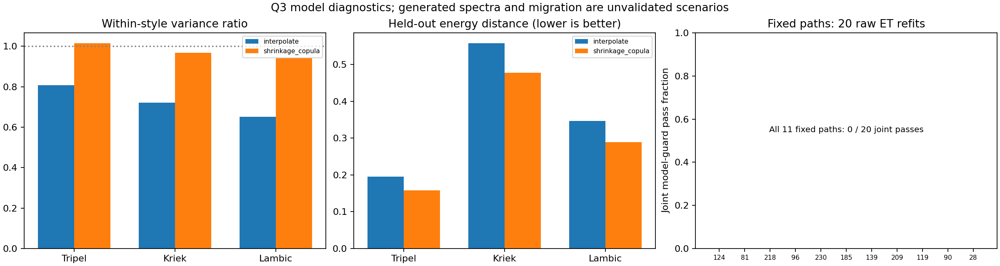

# 任务4：Q3生成诊断与原始量尺完整约束

本项按既定范围完成，结果位于`outputs/task4_raw_q3_20261026/`。**生成主方法保留同风格插值，但保留方差收缩和近重复诊断；原11条迁移路径、原77个权重方案及8293个历史候选均未通过本轮完整原始评分/概率筛选，不再把旧“11款通过”当作当前结论。**

生成画像已与R2补充的原始0～6分和概率输出衔接，两项乙醛继续留空。任务4的计算与诊断完成，不等于Q3的真实风格迁移及缺陷不恶化已经得到验证。Q1模型、Q2主表保持不变，本项没有启动任务5。

## 固定范围及比较方法

[协议](../configs/task4_raw_q3_protocol_20261026.json)在新实验前写定，基点`1a1064f`。输入仍为250款、226项直接测量属性加5个派生字段共231输入，沿用排除7个未闭合汇总字段后的224项。源数据、R2补充模型、R3弱预测状态和旧候选池均记录来源校验值。

生成只比较两种预定方法：原Beta(2,2)双亲本插值，以及一个收缩高斯Copula。后者在每种风格内对训练样本作中位秩正态变换，以Ledoit–Wolf估计收缩协方差并转成相关矩阵，采样高斯向量后经正态CDF及经验边际逆插值回到附件坐标。常数边际保持常数，输出受训练经验边际约束；没有把原始输入直接当浓度混配，也没有在结果出来后调整收缩参数。协方差实现依据[scikit-learn官方LedoitWolf接口](https://scikit-learn.org/1.7/modules/generated/sklearn.covariance.LedoitWolf.html)。

每种风格每次生成100条。比较沿用与R2一致的三折，生成器的填补、边际、相关结构及变换只拟合当前训练啤酒。Tripel、Kriek、Lambic共9个风格×折，双方法18个比较案例；对应实测总样本数分别只有28、10、11款。全数据600条候选另存，最后选择的方法交付300条画像。原300条插值谱已逐值重建确认一致。

生成化学空间诊断使用当前训练集拟合的asinh坐标，包括逐列Wasserstein距离、联合energy距离、总方差比、秩相关误差、留出覆盖、精确复制和近重复。覆盖半径是该风格训练样本留一最近邻距离的95%分位；近重复半径预先固定为其留一最近邻距离中位数的5%。近重复率表示“至少有一个邻居落在这个诊断半径内”的样本比例，不是精确重复计数或赛事官方阈值。

感官比较调用相应外层训练的R2模型，对生成谱和留出实谱都作预测，分别比较：生成预测等级与留出模型等级、与留出实测加权中位等级；原始ET评分分布与留出模型/实测评分分布。它们是生成器加预测器的联合诊断，不能把生成谱的模型分数叫作真实品评分数。模型一致的分布距离还会受到预测器收缩影响，不能单独当生成质量证明。

## 生成结果与方法取舍

以下为三种风格、三折等权平均，不能与旧22风格总体比较直接混用。

| 诊断 | 插值 | 收缩Copula |
|---|---:|---:|
| 留出边际W1（越低越好） | 0.401069 | 0.384720 |
| 留出energy距离（越低越好） | 0.366649 | 0.308010 |
| 相对训练风格总方差 | 0.725986 | 0.975149 |
| 秩相关RMSE（越低越好） | 0.147289 | 0.271016 |
| 留出覆盖比例 | 94.88% | 92.10% |
| 模型一致的原始中位等级W1 | 0.128131 | 0.115768 |
| 对实测中位等级的W1 | 0.367420 | 0.384479 |
| 精确训练复制率 | 0% | 0% |
| 生成集内部近重复率 | 26.89% | 0% |

Copula改善方差、边际和联合距离，并减少本次近重复；但秩相关误差超过预设允许值（插值+0.05），Kriek留出覆盖从91.67%降到83.33%，超过允许的5个百分点下降。它没有通过全部替换条件，**不替换插值**。不能只挑方差改善或某个留出距离宣布优化成功。

原插值的弱点继续报告：在三折内Tripel/Kriek/Lambic方差比分别为0.8071/0.7204/0.6504，存在收缩；本轮全数据各100条主展示谱的内部近重复率分别为2%/19%/21%，虽然没有精确复制实样本。`generation_profile_diagnostics.csv`逐谱记录最近实样本、最近生成样本、距离、范围和重复标记，不能用“无精确复制”替代多样性检查。

同一三折上，两个固定风格分类器的全22风格OOF准确率为52.0%和53.2%。这些是本轮划分的实际结果，不能沿用旧不同划分的成绩。全量拟合分类器对生成样本的判别另表保存，不是风格真实性认证。

方法选择使用了上述开发划分，选择后的指标不能声称是未经选择的最终独立测试成绩。下一项冻结后重复验证仍待用户指令。

## 迁移池、七档权重与完整五缺陷检查

本次没有扩大旧锚点、步数或候选范围。只重建`review_path_tradeoff_20261025`的8293条历史连续代理约束可行路径，保留其旧模型资格作为来源。旧连续Stale代理没有对8293点全部重新拟合核验；本轮重新检查坐标上限、Tripel范围、两个风格模型及当前原始评分条件。来源是旧有限池，结果不能推广成全空间可行性判断。

四项化学坐标DMS、Diacetyl、4VG、trans-2-nonenal不得超过准备后的源上限，不强迫缺陷达到Tripel经验下限。119、28两款Diacetyl原CSV缺失，仍只采用附件8零参考在非负浓度假设下的条件零上限，**没有把填补中位数当实测上限**。没有新增未经统一单位的浓度阈值计算。

对五类感官缺陷dms、diacetyl、X4vg、t2n、stale_hops，当前完整模型情景要求：

1. 原始0～6整数预测均不增加。
2. 评分至少1、至少5、恰为6的概率均不增加。
3. 第2项对校准流程及所选来源的未校准概率分别检查，数值容差`1e-10`。

这是一组**本轮预先声明的保守模型筛选条件**，不是把模型概率升级成了真实干预风险界限。R2补充只有四类缺陷的非零概率相对常数基线有历史支持，高分事件没有同等验证；Stale仍证据不足。R3五缺陷中位模型也均属弱预测。因此通过只能称未验证模型情景，未通过也不能叫实测缺陷恶化。

七档目标距离权重为0.5/0.6/0.65/0.7/0.75/0.8/0.9，共77个旧选择。若有完整通过者，才在同一检查后的池中按距离/改动目标重新选取；空池就保留失败状态，不放宽门槛凑方案。主权重仍为0.7。

实际结果：

- 8293条中8259条通过五项整数等级不增加；34条在4VG等级上升。
- 校准及未校准的全部五缺陷三事件概率共同检查后，完整通过数为0。
- 原11条固定路径的整数等级检查均通过，但概率联合检查均未通过。
- 原77个权重选择均未通过；重新筛选后七档权重也均没有完整通过候选。

主要冲突不只是Stale：例如4VG“至少5分”的概率非增加仅有约3.71%的池中路径通过，Diacetyl“6分”约1.94%通过；而Stale非零事件约99.60%通过。单项和逐源淘汰量另表记录。尾部概率本身尚未充分验证，严格零增量筛选也可能受模型误差、源样本拟合偏差及合成点分布变化影响；本轮不利用事后放宽概率容差来扭转结论。

所以`transfer_results.csv`保留全部11款失败状态，新的`transfer_profiles.csv`及选中画像表为空但含完整列名；旧11款的谱、52项前后画像及55条缺陷检查仍提供作历史情景对照。**当前不能把“11款风格迁移且缺陷不恶化”写成已经实现的结果；也不能将这里的0通过写成现实酿造无解。**

## 原11条固定路径的重拟合稳定性

新增20次按风格保持样本量的啤酒bootstrap，只重拟合固定参数的原始评分ET。每次抽到的啤酒实例总评分权重仍为1，保留其原品评员/重复呈样分权；训练填补依据重采样啤酒实例，不依据展开后的品评记录数。只评价原先选定的11条前后路径，没有借重拟合重新搜索路径。

重拟合模型重新计算整数等级及未校准ET三事件概率；没有把原森林的sigmoid校准器贴到新森林上。11条路径的“五类等级及三事件概率共同不增加”比例全部为0/20；每款另有3～11次源啤酒不在重采样训练中的情景，分层后的共同通过率同样为0。分层只诊断固定路径对模型拟合的敏感性，不把先前用全数据选定的路径变成独立干预试验。

旧200次标准化Stale三代理联合通过比例35%～96.5%仍单列复用；它们是不同标签、模型和约束，不能把两组通过率当同一指标的前后提升/退步。重拟合分位数不是干预效果置信区间。

20次OOB原始评分MAE的平均为0.797730，训练先验基线0.830699。Stale非零事件未校准Brier平均为0.105920、基线0.106351；这些重叠OOB样本的开发诊断不构成新的独立显著性证据，不升级R2补充的Stale证据状态。



## 文件与使用

- `generated_profiles.csv`、`generated_metadata.csv`：保留的300条主插值谱及亲本、种子、坐标说明。
- `generated_sensory52.csv.gz`、`generated_grades_all52.csv`、`sensory_fingerprints52.csv`：原始评分与概率画像，15600条逐项输出，600条乙醛位置空分数/空概率。分位数是合成样本间变化，不是预测置信区间。
- `generation_candidate_profiles.csv`、`generation_candidate_metadata.csv`、`generation_candidate_sensory52.csv.gz`：双方法全部600条谱及31200条画像，没有筛掉不好看的样本。
- `generation_validation.csv`、`generation_validation_by_target.csv.gz`、`generation_replacement_checks.csv`：18个风格×折×方法比较、900条逐目标感官诊断及完整替换门槛。
- `generation_profile_diagnostics.csv`、`generation_full_training_diagnostics.csv`、`generation_style_predictions.csv`、`style_oof.csv`、`style_classifier_metrics.csv`、`copula_fit_parameters.csv`：逐谱近重复/范围、全训练描述、风格预测与本轮OOF、收缩参数。
- `migration_grid_checks.csv.gz`、`migration_constraint_attrition.csv`、`defect_guard_pass_fractions.csv`：全部8293点的完整检查、逐源淘汰与缺陷事件冲突，不只是最终成功点。
- `weight_choices_complete.csv`、`original_weight_five_defect_checks.csv`：77个旧权重选择的补验及385条缺陷明细；新选择为空的原因明确保留。
- `transfer_results.csv`、`transfer_profiles.csv`、`transfer_sensory52.csv.gz`、`transfer_grades_all52.csv`：当前11源状态及通过完整模型筛选后的结果；本轮选中数为0，后几张仅保留表头。
- `original_fixed_path_results.csv`、`original_fixed_path_five_defect_checks.csv`、`original_fixed_path_sensory52.csv.gz`、`transfer_source_profiles.csv`、`source_defect_evidence.csv`：旧11条路径的当前口径复核与源假设；不把它们当新通过方案。
- `raw_fixed_path_refit_changes.csv`、`raw_fixed_path_refit_summary.csv`、`fixed_path_joint_refit_comparison.csv`、`raw_refit_draws.csv`、`raw_refit_oob_metrics.csv`：20次新重拟合、源在袋/袋外分层及旧200次证据对照。
- `protocol.json`、`summary.json`、`verification.json`：冻结范围、来源及复核结论。全部真实干预/安全认证字段均为False。

## 重建与核验

安装原核心锁定依赖即可，不新增SHAP依赖。需要原附件目录及R2补充父模型（包含三个外层模型）；父模型未随Git上传，缺少时先重建。PowerShell：

```powershell
.venv/Scripts/python.exe -m pip install -r requirements-lock.txt
.venv/Scripts/python.exe scripts/fetch_raw_sensory.py
.venv/Scripts/python.exe scripts/r2b_tail_risk.py --source '原始附件目录' --output outputs/my_r2b
.venv/Scripts/python.exe scripts/task4_raw_q3.py --source '原始附件目录' --q1 outputs/my_r2b --output outputs/my_task4
.venv/Scripts/python.exe scripts/verify_task4_raw_q3.py --source '原始附件目录' --q1 outputs/my_r2b --output outputs/my_task4 --cache checkpoints/my_task4_replay
$env:PYTHONPATH='src'
.venv/Scripts/python.exe -m unittest discover -s tests
```

各输出和核验缓存目录须不存在；已有原始CSV可传`--raw '文件路径'`。本机父结果默认`outputs/r2b_tail_risk_20261026`。不需要重建旧19步链，也没有把那条旧链宣称为本轮复现。父模型按当前运行的R2补充summary核对哈希；其他仓库文本来源哈希规范化CRLF→LF，原始附件/评分仍用字节哈希。

132项测试通过。独立重放8次生成器拟合、8个风格分类器和20个ET重拟合，核对39张结果表、全部8293点、77项选择/385条缺陷、15600条主画像及600个缺标签空位；另独立从逐事件差值重新计算完整约束、空池和权重最优/支配关系。R2补充父模型与旧200次实验按版本复用，没有冒称在本轮重新训练；核验是同数据、同冻结协议的数值复现，不是外部科学验证。

本项推送main后停止。下一项为任务5“冻结方法后的重复嵌套验证”，须收到用户指令后开始；真实酿造、配对品评和缺标签信息不因代码验证通过而补齐。
