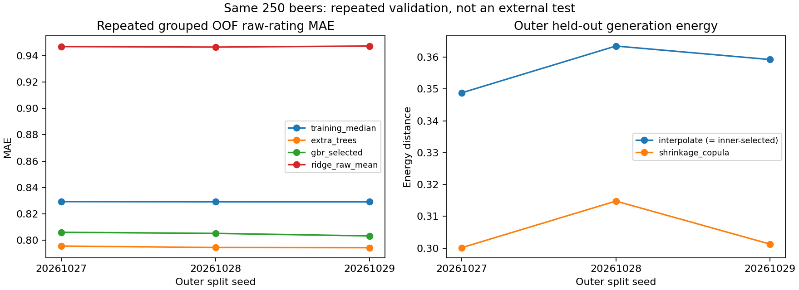

# 任务5：冻结方法后的重复嵌套验证

任务5已完成。固定三个随机划分后，**现用Extra Trees的原始评分MAE均值为0.794561，三个重复间样本标准差0.000682**；相对训练中位数的改善保持一致。高分识别、Stale证据不足、精确因素排名不稳和生成方差收缩等限制仍在。本项没有替换Q1/Q2/Q3部署结果，任务4的完整迁移筛选零候选继续保留。

结果位于`outputs/task5_repeated_nested_20261026/`，含全部三个重复、九个外层上下文和十八个内层上下文，没有只挑表现最好的划分。

## 冻结与分组

[协议](../configs/task5_repeated_nested_protocol_20261026.json)在训练前固定，基点`ea9c47a`。外层种子为20261027、20261028、20261029，各三折；每个外层训练集再做两折。啤酒为划分单位，所有品评员及重复呈样记录跟随同一啤酒。输入仍为250款、226项测量属性加5项派生量，沿用排除7项未闭合汇总量后的224个预测字段；原始评分权重、整数中位决策及父子封顶规则不变。

- Q1整数评分冻结为已经采用的ET，不重开失败的尾部代价调参，也不冒称重新搜索了旧Q1全部候选。
- 风险来源沿用R2补充的训练内OOF选择：逐目标从训练先验、ET和有序模型中按未校准非零Brier选择，再在外层训练集的内层OOF值上拟合校准器。外层标签不参与选择和校准。
- Q2继续在内层全50目标原始MAE上选择GBR深度1/2，Ridge固定alpha=1000、响应为原始评分均值。SHAP只解释外层留出样本，100个背景啤酒均来自对应外层训练集。
- Q3固定展示方法仍为插值；另外在每个外层训练集的两折内，重新执行原插值/Copula替换条件，再到外层比较固定候选及“训练内选择流程”。没有根据外层距离挑选新方法。

三个重复产生750次啤酒折外预测，**仍只有250款不同啤酒**。表中均值、样本标准差和范围描述这三个划分的变化，标准差不是置信区间。配对bootstrap先把每款的损失差跨重复平均，再在250款内按风格分层抽样，未把750次预测当750个独立样本。95%/99%区间仅针对已固定OOF损失，不覆盖完整重新训练、方法开发和干预效果的不确定性。

同一250款已经用于前期方法开发，本轮是冻结规则的重复开发验证，不是新增外部独立测试，也不检验新风格、新品评员或真实酿造后的效果。

## Q1评分及高分表现

| 外层种子 | 训练中位数MAE | 现用ET MAE | 内选GBR MAE | 原始均值Ridge MAE |
|---|---:|---:|---:|---:|
| 20261027 | 0.829163 | 0.795345 | 0.805828 | 0.947143 |
| 20261028 | 0.829012 | 0.794239 | 0.804984 | 0.946742 |
| 20261029 | 0.828986 | 0.794099 | 0.803065 | 0.947549 |
| 均值 | 0.829054 | 0.794561 | 0.804626 | 0.947144 |

ET相对基线的平均MAE改善为0.034493，按上述啤酒平均损失计算的固定OOF配对95%区间为[0.030612, 0.038213]。ET在每个重复都优于本轮GBR和Ridge对照，支持保留已经采用的评分方法。这是相同方法在其他划分上的表现，不能写成“更换算法后由0.795214提升到0.794561”。

ET个人5分、6分精确召回在三个重复中仍均为0；对实测加权面板中位数的MAE均值为0.391813。总体误差稳定不代表高等级识别已经解决。GBR有很小的5分召回（约0.13%～0.46%），6分仍为0，且整体MAE更高，未据此替换Q1。Ridge比较的是均值响应，不应把它的较高绝对误差解释为所有线性方法都无价值。

## 五类缺陷概率与校准

以下为三个重复的非零评分事件平均Brier；越低越好，仍是按R2品评权重抽取一次评分是否至少1的预测，不是化合物超阈值或干预风险。

| 目标 | 训练先验 | 未校准ET | 训练内选择后校准 | 校准流程相对先验改善的99%区间 |
|---|---:|---:|---:|---|
| Diacetyl | 0.200798 | 0.197146 | 0.198457 | [0.000885, 0.003698] |
| DMS | 0.224017 | 0.219357 | 0.220142 | [0.001273, 0.006459] |
| 4VG | 0.188049 | 0.171388 | 0.171624 | [0.010676, 0.023101] |
| t2n | 0.158028 | 0.155446 | 0.156466 | [0.000377, 0.002744] |
| Stale hops | 0.107324 | 0.106990 | 0.107118 | [-0.000219, 0.000562] |

四项非零事件相对先验的历史支持与此前结论一致；Stale区间仍跨0，不升级证据状态。高分事件没有由这张非零表得到验证。全部目标、三个事件、五种概率流程、校准前后和可靠性分箱均另表保留。

**校准仍没有普遍提高Brier表现**：表中五项的校准流程都弱于单独未校准ET，其中还包含训练内来源选择的影响，不应把全部差异简单归因于sigmoid。没有按外层结果事后选择哪个版本作为更好成绩；现有部署概率输出与前后对照保持不变。历史预测改善也不等于迁移后缺陷不恶化。

## 因素排名的重复稳定性

九个外层上下文全部在训练内选择GBR深度2。三个重复各有17个目标产生非零GBR排名、各51条；另外33目标的99个位置按“模型零归因”留空。Ridge每个重复有150条。每种方法另保留两项乙醛的6个缺标签位置：全表3重复×2方法×52项×3位共936位置，其中36位缺标签，297位是GBR零归因，原因分开记录。

| 比较 | GBR | 原始均值Ridge |
|---|---:|---:|
| 同一重复中外层折之间的平均Top-3 Jaccard | 0.164706 | 0.280889 |
| 三个重复的全局Top-3之间平均Jaccard | 0.435294 | 0.918000 |

GBR的平均数只包含17个非零目标：前者153个非空折对、后者51个非空重复对；Ridge分别为450和150个，覆盖50目标。不同目标集合、响应概括和排名分数不能混称公平的因果识别比赛。

跨折聚合后Ridge全局榜单更一致，但其单折前三项仍有变化；GBR全局精确前三项也只有中等一致性。两个都空的排名未算成完美一致。稳定的模型关联仍不能自动成为可干预化合物，原始均值Ridge与连续中位GBR也不是现用Q1 ET的等价解释。旧标准化响应的P/q值及重训频率没有迁移到新排名，219单体与220家族口径继续分列。

## 生成方法与历史迁移路径

九个外层训练集的内层选择全部保留插值；以下为外层结果跨三个重复的平均，风格与折等权。

| 指标 | 插值／训练内选择流程 | 收缩Copula |
|---|---:|---:|
| 留出边际W1 | 0.396445 | 0.389104 |
| 留出energy | 0.357189 | 0.305405 |
| 方差比 | 0.711005 | 0.981506 |
| 秩相关RMSE | 0.148808 | 0.270957 |
| 留出覆盖 | 93.27% | 91.93% |
| 生成集内部近重复率 | 28.33% | 0% |
| 模型一致中位等级W1 | 0.095664 | 0.078982 |
| 对实测中位等级的W1 | 0.332651 | 0.359460 |

Copula在距离/方差上的优势与相关结构的损失继续并存。插值内部近重复率在三个重复间为25%～32%，定义仍为任务4固定的近邻诊断半径，不能叫作精确重复比例。保留插值是按既定取舍，不能写成其分布质量已全面达标。54个外层风格×折×方法案例、5400条生成谱及2700条逐目标感官摘要均保存，未筛掉不理想的案例。

两种风格分类器OOF准确率也按全部重复保留：ET为56.4%/52.8%/54.4%，Logistic为50.4%/53.6%/52.0%。它们不构成合成啤酒风格认证。

历史11条路径只作固定情景敏感性检查：每个重复调用源啤酒所在留出折的模型，记录165条五缺陷明细、33个路径上下文；没有重新选锚点、权重或搜索候选。其中仅119号在种子20261027的一次上下文通过感官子检查，另外32次未通过，没有路径在三次都通过。119号沿用的Diacetyl准备值还是条件零上限，原始缺测没有恢复。

**这1次不改变任务4的零候选。** 历史路径及其准备坐标曾利用全数据选定，本轮没有重做所有坐标、风格和范围检查，也没有迁移后品评；它不是嵌套迁移成功率，更不是新的完整通过方案。任务4原8293点在完整规则下的结果继续有效。



## 主要文件

- `q1_metrics_by_repeat.csv`、`q1_repeat_summary.csv`、`predictive_metrics_by_target.csv`、`loss_by_repeat_beer.csv`：全部重复和逐目标表现；样本标准差按重复计算。
- `q1_oof_scores52.csv.gz`：39000条原始等级与校准前后概率，1500条乙醛位置保持空值，不输出假标签。
- `risk_metrics_by_repeat.csv`、`risk_repeat_summary.csv`、`risk_reliability.csv`、`paired_beer_averaged_intervals.csv`：五种流程与三个事件、啤酒平均后的配对区间。
- `q2_repeat_top3.csv`、`q2_family_top3_supplement.csv`、`q2_all52_rank_slots.csv`、`q2_rank_coverage.csv`、`q2_rank_stability.csv`：每个重复的排名、覆盖与折对/重复对一致性；完整分数见两张压缩importance表。
- `generation_inner_validation.csv`、`generation_inner_gate_checks.csv`、`generation_outer_validation.csv`、`generation_selected_outer_validation.csv`：108个内层生成比较、117条门槛记录和54个外层比较，选择位于内层。
- `generation_outer_sensory_by_target.csv.gz`、`generation_metrics_by_repeat.csv`、`generation_repeat_summary.csv`：外层逐目标和重复摘要；`outer_generated_spectra.npz`保存全部5400条谱。
- `grouped_splits.csv`、`background_beers.csv`、`gbr_inner_selection.csv`、`risk_inner_selection.csv`、`calibration_parameters.csv`、`model_fit_log.csv`：外层/内层分组、背景、选择与拟合参数追溯。
- `oof_arrays.npz`、`gbr_OOF_SHAP.npz`、`shap_additivity.csv`、`inner/*.npz`：所有评分/概率数组、840万SHAP单元与九组内层OOF缓存，均记录目标/字段或与来源顺序一致。
- `fixed_historical_path_sensitivity.csv`、`fixed_historical_path_joint.csv`：历史固定谱敏感性，不并入当前迁移成功数。
- `summary.json`、`verification.json`：冻结来源、验证范围及边界。模型二进制不上传，按命令重建。

## 重建和核验

需要包含SHAP的R3锁定依赖和原始附件；无需旧模型二进制，也不需要重跑旧19步。输出目录须不存在：

```powershell
.venv/Scripts/python.exe -m pip install -r requirements-r3-lock.txt
.venv/Scripts/python.exe scripts/fetch_raw_sensory.py
.venv/Scripts/python.exe scripts/task5_repeated_nested.py --source '原始附件目录' --output outputs/my_task5
.venv/Scripts/python.exe scripts/verify_task5_repeated_nested.py --source '原始附件目录' --output outputs/my_task5
$env:PYTHONPATH='src'
.venv/Scripts/python.exe -m unittest discover -s tests
```

已有固定原始评分可传`--raw '文件路径'`。内层较小训练集中可能存在非生成风格的单样本类别；Copula现在允许只拟合请求生成的三个风格，填补仍用全部当前训练啤酒。原默认接口行为及任务4参数不变，新增测试覆盖该真实嵌套场景。

136项测试通过。核验独立重拟合全部108个预测学习器、18个风格分类器及54次生成器，重新检查九组内层概率/GBR等级、来源选择、校准、全部34张表、840万SHAP值、5400条生成谱和缺标签空位。最大SHAP加和误差约`3.47e-8`，解释的仍是取整前连续GBR输出。

首次运行九组模型和内层缓存均完成后，汇总代码因两个指标字典共有`raw_rating_mae`而报错。修正合并后复用已完成外层模型，额外重拟合18个内层ET以恢复生成摘要；冻结协议、种子和候选未变，随后完整独立重拟合核验通过。交付日志记录126个协议模型的上下文/参数，未编造已丢失的首次耗时；本地恢复过程另记summary。新机器按最终脚本正常完成126个学习器加54次生成器拟合即可。

本项没有使用重复结果事后修改正式方法，也没有开始任务6。完成推送后停止，下一项为最终复现与论文取数交付，待用户指令。
