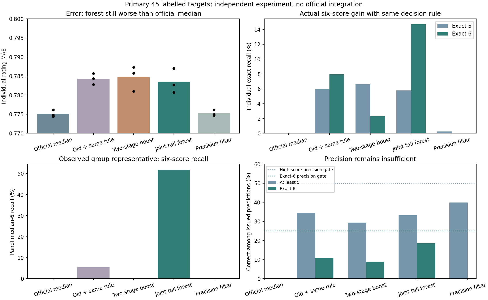

# Q1高分独立实验：有局部收益，尚未达到接入标准

基点`2c81417`。**未修改正式模型、默认预测入口、原始数据、用户“交付”目录、Q2或Q3。第一阶段仍未验收，不进入第二阶段。** 本目录所有模型均为实验候选；`experiment_success=false`与`integrated=false`是当前结论，核验程序的`status=passed`仅表示计算及调用核对通过。

本轮找到的实际收益是：联合随机森林在相同出分规则下，主要内容45项的个人6分精确召回从7.95%升至14.70%，真实面板代表值6分召回从5.56%升至51.85%。但个人6分精确率只有18.55%，≥5精确率33.19%，不推荐直接接入。训练内精确率过滤使6分全部回退，也未解决问题。

## 同口径结果

以下为相同250款、三次历史重复切分的折外结果；个人评分仍按啤酒等权、啤酒内品评员等权及重复呈样分权计算。**不是750款独立啤酒，不是新增外部测试。** 表中45项为有标签的主要内容，50项及逐目标/逐等级结果另存，两个乙醛评分始终留空。

| 主要内容45项 | 个人MAE | 个人5分精确召回 | 个人6分精确召回 | 个人6分精确率 | 面板6分召回 |
|---|---:|---:|---:|---:|---:|
| 正式原中位模型 | 0.775113 | 0% | 0% | 无6分预测 | 0% |
| 上次未采用候选 | 0.783212 | 3.98% | 6.58% | 10.30% | 5.56% |
| 旧概率＋本次同一出分规则 | 0.784290 | 5.96% | 7.95% | 10.87% | 5.56% |
| 两阶段提升树 | 0.784706 | 6.61% | 2.30% | 8.79% | 0% |
| 联合高分随机森林 | 0.783478 | 5.79% | 14.70% | 18.55% | 51.85% |
| 随机森林＋训练内精确率过滤 | 0.775265 | 0.26% | 0% | 无6分预测 | 0% |

`comparison.csv`同时包含50项结果、≥5及面板精确率、重复预测数量；`comparison_by_repeat.csv`保留逐次成绩。精确率按合并预测的命中质量/预测次数计算，不把无预测时的精确率写成0。原模型总共只发出2个高分预测，不能用其≥5精确率100%描述充分的高分识别。

森林在45项的三次个人6分召回为16.13%、15.74%、12.24%，面板6分召回50.00%、55.56%、50.00%。相比相同规则旧概率，个人6分召回平均增加6.75个百分点，但按啤酒配对重采样的95%区间为[-0.17, 14.11]个百分点，仍跨0；面板6分召回增量区间为[4.75, 75.01]个百分点。区间条件于这批固定折外预测，不覆盖重训/连续方法开发的不确定性。

面板6分在45项里仅18个“啤酒×目标”组合，来自9款啤酒；森林三次命中28个重复位置，覆盖11个不同组合、5款啤酒。约86%的面板6分命中集中于Malt总体与Burn细分项，不能推广为全部感官维度都改善。`six_by_target.csv`保留逐目标支持、命中和精确率。

森林MAE比正式模型增加0.008365，配对95%区间[0.004709, 0.012431]；比相同规则的旧模型平均减少0.000812，但区间[-0.004384, 0.002715]跨0，不能宣称可靠降低整体误差。

50项口径中，森林个人5/6召回为10.12%/14.46%，MAE为0.806674。重复0的面板高分假阳性率2.03%，重复1的个人/面板高分假阳性率2.14%/2.37%，超过2%门槛。不能只报45项较好的误报率而忽略完整输出。

6分概率的逐目标宏平均AP从0.04073升至0.05754、Brier从0.009628降至0.009508，但AUC从0.68309降至0.66738，≥5概率也未全面改善。这支持“部分高分排序有收益”，不支持“概率模型全面更好”。无正例事件的AUC/AP留空，事件质量直接求真实尾部比例之和，避免累计相减舍入伪造微小正例。



## 做了哪些实际训练

1. `protocol.json`在训练前固定两阶段提升树：每目标先学`P(Y>=5)`，再学`P(Y=6|Y>=5)`。用真实评分比例作分数标签，类别平衡只在当前训练内计算，输出还原类别先验偏移。模型使用100棵深度2提升树。第二阶段高分事件稀少，泛化结果比旧概率差，否决该模型。
2. 查看第一种失败结果后，另冻`protocol_joint_forest.json`：每目标直接学“0～4、5、6”三类真实比例；300树、最小叶3款、max_features=0.7、按唯一啤酒bootstrap。响应除以训练类别比例的平方根以提高稀有6分的分裂权重，再还原响应；概率仍是原始比例的叶均值，没有造高分标签或把类别平衡概率当自然概率。此前看过的验证数据继续被复用，这属于连续开发。
3. 森林6分识别改善但精确率不足，再冻结`protocol_confidence.json`，只在内层折外记录上学习逐目标≥5精确率50%、6精确率25%、至少3款预测支持的过滤。弱项目回退原评分，接受的细分项依评分卡规则向上保持父项一致。没有重训概率估计器，结果6分全回退，否决这项出分策略。

两类概率模型分别执行外三折×三次重复，内两折选择评分政策；另做全量训练内选择及全量实验模型。每次填补只拟合当前训练的唯一啤酒，同款啤酒全部品评记录跟随同一折。风格只用于切分，编号和风格不作为预测特征。

原0～4的条件分布由原ET提供，两类候选重学高分部分。对新/旧概率应用相同24种代价政策、相同训练内选择，避免把规则变化当成新模型收益。政策仅在训练内按两种范围的MAE及误报上限筛选，再按45项最差等级召回选择，未用外层最优政策。全部固定政策结果保存在`fixed_policy_metrics.csv`。

## 为什么不推荐接入

在查看新结果前固定：原有个人MAE增量≤0.02、个人及面板≥5假阳性率≤2%、个人与面板5/6各自召回≥5%，要求每次重复及两个范围均满足；另要求45项≥5精确率至少50%、6分至少25%，避免大部分高分预测都错。这些是团队试验标准，不是题面规定。没有在看到结果后降低门槛。

森林≥5精确率33.19%，表示约66.81%的高分事件预测不正确；6分精确率18.55%，约81.45%的个人6分预测不正确，面板6分精确率更只有11.29%。过滤后6分召回归零，没有同时获得精确率与召回。`success_checks.csv`逐次列出失败条件。

额外缺失敏感性只对有收益的森林运行：9个外层模型×5%/10%/20%随机遮盖，共27个固定MCAR掩码，原有缺失保留，不重选政策。45项MAE为0.784217/0.784429/0.785135；相应正式模型为0.776903/0.778488/0.781616。不能外推为信息性缺失或真实酿造验证。

## 运行和核验

Python3.12及仓库`requirements-r3-lock.txt`，没有新增依赖。原始评分使用现有固定SHA256的本机CSV，不上传Git。复用已核验的R2身份台账和`outputs/q1_target_20261026`旧概率缓存；不依赖旧模型二进制。新输出目录必须不存在。

```powershell
# 以下以仓库根目录为工作目录；SOURCE为原始附件目录。
.venv/Scripts/python.exe experiments/q1_two_stage_20261026/run.py --source SOURCE --protocol experiments/q1_two_stage_20261026/protocol_joint_forest.json --output experiments/q1_two_stage_20261026/my_forest
.venv/Scripts/python.exe experiments/q1_two_stage_20261026/predict.py --model experiments/q1_two_stage_20261026/my_forest/experiment.joblib --input SOURCE/1.csv --output experiments/q1_two_stage_20261026/my_forest/prediction_smoke
.venv/Scripts/python.exe experiments/q1_two_stage_20261026/verify.py --source SOURCE --protocol experiments/q1_two_stage_20261026/protocol_joint_forest.json --output experiments/q1_two_stage_20261026/my_forest
```

两阶段对照：训练时省略`--protocol`，改用另一个新输出目录；核验同样省略该参数。过滤对照运行`confidence.py --source SOURCE --parent <森林结果目录> --output <新目录>`，其核验为`verify_confidence.py`对应相同参数；推断仍用独立`predict.py`，不调用正式入口。`report.py --source SOURCE`汇总本目录三个已发布结果快照并重画图，不要求重训。

当前本机可直接用`forest_results/experiment.joblib`调用独立预测。模型二进制和内层概率训练缓存不上传Git；从新克隆必须按上述命令训练到新目录后核验。原始附件、逐品评记录和下载工作簿均不随本实验上传。

代码验证：8项针对分数标签权重、先验还原、无标签事件、父子规则及指标汇总的检查通过。两类模型分别重放29个保存模型（20内层、9外层），另独立重拟合1个外层模型；未再次独立拟合全部内层模型。10个训练内选择上下文、全部政策指标、各13000行独立CLI及500个乙醛空位核对通过。过滤的1000行训练内门槛另逐项重建，概率模型未重训。核验通过不代表建模质量通过。

既有`src/`、`scripts/`、`configs/`、`outputs/`和项目README均没有差异。正式模型和旧风险概率保持原样，Q2解释及Q3迁移结果未被本实验替换。

本轮由OpenAI Codex辅助设计、编码、训练与核验，未使用子代理。实现使用scikit-learn现有分类器及回归森林；[提升树分类器接口](https://scikit-learn.org/1.7/modules/generated/sklearn.ensemble.GradientBoostingClassifier.html)。结论为独立实验的局部收益与未满足项，不是第一阶段已经解决，也不是迁移安全认证。
